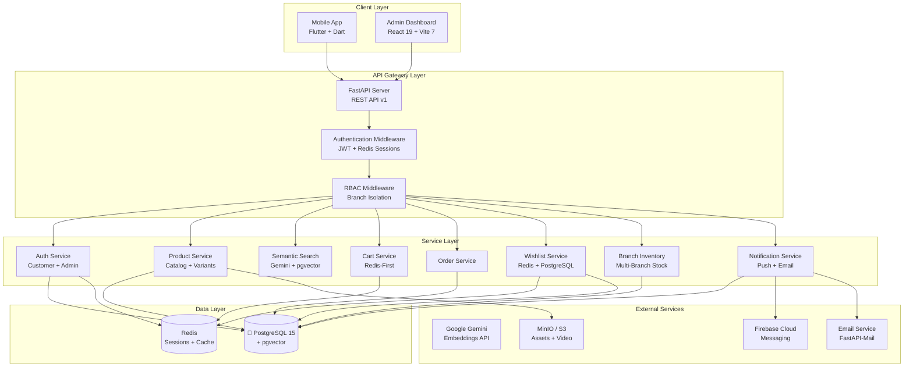
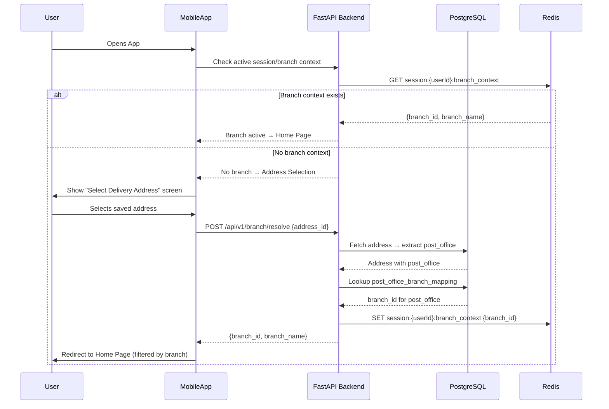
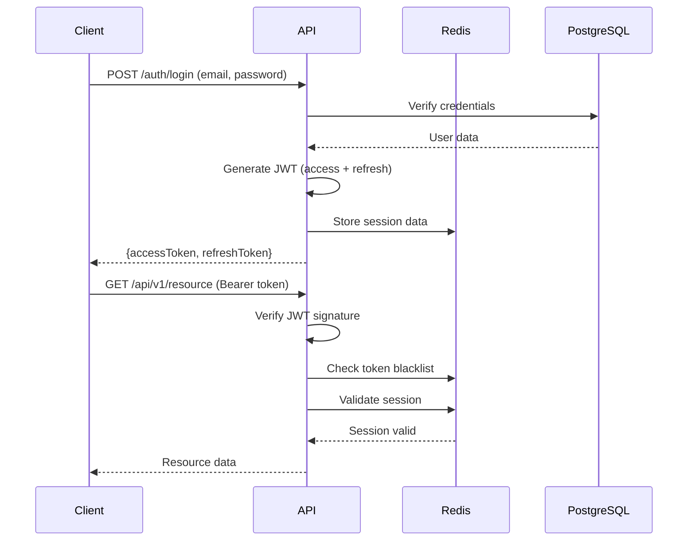

# SRIBEESonline - Technical Architecture

> **Document status**: partially re-verified 2026-08-10 against the live database,
> the running backend, and the actual admin dashboard source. Sections below are
> marked **✅ Verified 2026-08-10** where every claim was checked directly (live
> schema query, reading the actual route/service code, or exercising the real
> endpoint), and **⚠️ Not re-verified this pass** where the content is carried over
> from the February 2026 version without independent confirmation — treat those as
> "probably still true, but check the code before relying on specifics." The
> February 2026 version had drifted substantially in places that *were* checked (the
> RBAC role list, the database schema, the deployment story, the local dev
> infrastructure) — see each section for what changed and why.

## 🏗️ System Architecture Overview

SRIBEESonline is a **multi-branch grocery/delivery platform** — a React admin
dashboard, a Flutter mobile app, a separate React partner/referral portal, and a
Python FastAPI backend serving all three from one API. The system implements
**multi-branch RBAC** with 5 admin roles (not 6 — see [RBAC](#-multi-branch-rbac-architecture-verified-2026-08-10)
below), where branch isolation for inventory/orders/marketing is enforced in a single
shared FastAPI dependency (`inject_branch_filter`), not per-endpoint ad hoc logic. A
customer order's `branch_id` is resolved from the delivery address's Post Office via
`post_office_branch_mapping` — confirmed against the live schema; whether that
resolution is cached in a Redis "branch context" session as described further below is
**not re-verified in this pass**.

---

## 📐 Architecture Diagram



---

## 🔧 Technology Stack

### Frontend: React Web Admin Dashboard

| Component | Technology | Version |
|-----------|-----------|---------|
| Framework | React | 19+ |
| Build Tool | Vite | 7.3+ |
| UI Library | Ant Design | 6+ |
| State Management | TanStack Query | 5+ |
| Charts | Recharts | 3+ |
| Routing | React Router | 7+ |
| HTTP Client | Axios | 1.7+ |
| Type Safety | TypeScript | 5.6+ |
| Styling | CSS Modules + Ant Design |  |

### Mobile App: Flutter

| Component | Technology | Version |
|-----------|-----------|---------|
| Framework | Flutter | 3.x+ |
| Language | Dart | 3.x+ |
| Navigation | GoRouter | 12+ |
| State Management | Riverpod / Provider | 2+ |
| HTTP Client | Dio | 5+ |
| Storage | flutter_secure_storage |  |
| Push Notifications | Firebase Cloud Messaging |  |

### Backend: FastAPI (Python)

| Component | Technology | Version |
|-----------|-----------|---------|
| Runtime | Python | 3.11+ |
| Framework | FastAPI | 0.109+ |
| ASGI Server | Uvicorn + Gunicorn | 0.27+ |
| Authentication | python-jose + passlib[argon2] |  |
| Validation | Pydantic | v2+ |
| PostgreSQL Client | SQLAlchemy 2.0+ / asyncpg |  |
| Redis Client | redis-py (async) |  |
| Security | FastAPI Security + slowapi |  |
| Logging | Loguru |  |

### Databases

| Database | Version | Purpose |
|----------|---------|---------|
| PostgreSQL | 15+ | Users, Orders, Branches, Inventory, Products, Wishlist |
| Redis | 7+ | Sessions, Cache, Wishlist, Rate Limiting |

---

## 🔐 Multi-Branch RBAC Architecture (✅ Verified 2026-08-10)

### Role definitions — 5 roles, not 6

The February version of this doc described `staff`, `support` and `inventory` as
three separate roles alongside `marketing_manager`. The real, live `admin_role_enum`
(confirmed directly against the database) has exactly five values:

```python
# fastapi_backend/app/models/admin.py — the real enum
class AdminRole(str, Enum):
    SUPER_ADMIN = "super_admin"
    BRANCH_MANAGER = "branch_manager"
    MARKETING_MANAGER = "marketing_manager"
    INVENTORY_MANAGER = "inventory_manager"
    CUSTOMER_SUPPORT = "customer_support"
```

**Branch scoping — 2026-08-10 fix**: for a long time, every non-`super_admin` role was
scoped identically (pinned to exactly one branch, rejected if `branch_id` was `NULL`).
That's correct for Branch/Marketing/Inventory Manager (each genuinely runs one store)
but was wrong for Customer Support — a helpdesk role that has to be able to pull up
*any* customer's order, not just the branch they're nominally listed under. Fixed by
splitting the concept in two:

```python
# fastapi_backend/app/core/dependencies.py — the real, current code
UNSCOPED_ROLES = {"super_admin", "customer_support"}

class BranchScope:
    def __init__(self, is_super_admin: bool, is_unscoped: bool, branch_id: Optional[UUID]):
        self.is_super_admin = is_super_admin   # the literal role — for super-admin-only powers
        self.is_unscoped = is_unscoped          # "sees every branch" — Super Admin AND Customer Support
        self.branch_id = branch_id

    def resolve(self, requested_branch_id: Optional[UUID] = None) -> Optional[UUID]:
        if self.is_unscoped:
            return requested_branch_id   # None = every branch; Super Admin/Support may narrow via ?branch_id=
        return self.branch_id            # scoped admins always resolve to their own branch

async def inject_branch_filter(admin = Depends(get_current_admin)) -> BranchScope:
    role = admin.role.value if hasattr(admin.role, "value") else admin.role
    is_super = role == "super_admin"
    is_unscoped = role in UNSCOPED_ROLES

    if not is_unscoped and admin.branch_id is None:
        raise InsufficientPermissionsError(message="Your admin account is not assigned to a branch.")

    return BranchScope(is_super_admin=is_super, is_unscoped=is_unscoped, branch_id=admin.branch_id)
```

Every branch-scoped router depends on this the same way:

```python
router = APIRouter(dependencies=[Depends(require_roles("super_admin", "branch_manager", "inventory_manager"))])

@router.get("")
async def list_inventory(
    branch_id: Optional[UUID] = Query(None, description="Super Admin only: narrow to a branch"),
    scope: BranchScope = Depends(inject_branch_filter),
    db: AsyncSession = Depends(get_db),
):
    effective_branch = scope.resolve(branch_id)
    query = select(BranchInventory)
    if effective_branch is not None:
        query = query.where(BranchInventory.branch_id == effective_branch)
    ...
```

`require_roles(...)` gates *which roles can reach the endpoint at all*;
`inject_branch_filter`/`BranchScope.resolve()` gates *which rows they see once
they're in* — two separate, composable concerns, both real and both exercised by
every branch-aware admin endpoint (`admin_inventory.py`, `admin_orders.py`,
`admin_banners.py`, `admin_analytics.py`, `admin_transfers.py`).

### Permission matrix (from `admin/src/types/admin.types.ts` — `ROLE_PERMISSIONS`, the actual frontend source of truth, cross-checked against router-level `require_roles(...)` on the backend)

| Role | Branch scope | Products | Orders | Inventory | Analytics | Marketing (coupons/banners/quick-sale) | Users/Branches | Stock Transfers |
|---|:---:|:---:|:---:|:---:|:---:|:---:|:---:|:---:|
| `super_admin` | Every branch | Full CRUD | Full | Full | Network-wide | Full, any branch | Manage | Approve/reject/ship/complete, any |
| `branch_manager` | Own branch only | R/U | R/U | R/U | Own branch | Banners only | ❌ | Create/view only |
| `marketing_manager` | Own branch only | R | ❌ | ❌ | ❌ (403 — analytics is Super Admin + Branch Manager only) | Full, own branch | ❌ | ❌ |
| `inventory_manager` | Own branch only | C/R/U | ❌ | C/R/U | ❌ | ❌ | ❌ | Create/view/approve/ship/complete, own branch |
| `customer_support` | **Every branch** (fixed 2026-08-10) | R | R/U | ❌ | ❌ | ❌ | ❌ | ❌ |

Note the two genuinely cross-branch roles are Super Admin (by role) and Customer
Support (by the 2026-08-10 fix) — Marketing Manager and Inventory Manager are each
strictly pinned to one branch despite superficially sounding like network-wide
functions.

**Customer-list isolation — 2026-08-30 fix**: `GET /admin/customers`,
`/admin/customers/{id}/profile` and `/admin/customers/{id}/orders` (in
`admin.py`) were gated only on `get_current_admin` — every admin, including a
Branch Manager or a delegated staff account, could list and inspect *every*
customer in the network. Now gated on `customers:read` **and** branch-isolated
via `inject_branch_filter`: a scoped admin only sees customers with an order in
their branch, that customer's orders from their branch, and branch-scoped
lifetime stats. Editing/blocking a customer stays `super_admin` +
`customer_support`; `customers/{id}/role` and `/status` were also only
`get_current_admin` and are now locked down. The legacy network-wide
`admin.py` `/dashboard`, `/analytics/*`, `/recent-orders`, `/inventory/low-stock`
endpoints (superseded by the branch-scoped `admin_dashboard.py` /
`admin_analytics.py` / `admin_inventory.py`) are now `super_admin`-only.

### Order fulfilment workflow (branch-floor, 2026-08-30)

A customer's order is packed and dispatched by the **Branch Manager** of the
branch it was routed to (`orders.branch_id`), who either does it themselves or
delegates it to **fulfilment staff** — a `staff` account created under them via
`/admin/staff` holding `orders:read` + `orders:update` (`admin/src/pages/Staff`
has a one-click "Fulfilment Staff" preset). Inventory Manager has **no** order
access; it owns catalog + branch stock + transfers only.

Lifecycle (`orders.status`, a plain VARCHAR — no PG enum):

```
pending → confirmed → packing → packed → handed_to_courier
        → shipped → out_for_delivery → delivered      (+ cancelled, returns flow)
```

`packing / packed / handed_to_courier` are the branch-floor steps. They are
guarded by a state machine in `app/services/order_workflow.py`, enforced **only**
when an admin drives `PATCH /admin/orders/{id}/status` (`enforce=True`):

- Branch Manager / Customer Support / fulfilment staff are held to
  `ADMIN_TRANSITIONS` (forward progression + `packed→packing` correction +
  pre-dispatch `cancelled`). `GET /admin/orders/{id}/next-statuses` returns the
  legal moves; the admin UI mirrors the same map.
- `super_admin` bypasses the machine entirely (override to any state).
- Every **system** caller — the SribeesExpress webhook/sync, payment
  confirmation, cancellation helpers — passes `enforce=False` and is unaffected
  (a courier reporting `delivered` straight after `handed_to_courier` is
  authoritative, not a violation).

`processing` is the legacy pre-workflow state, treated as an alias of `packing`.

### Branch stock bookkeeping (2026-08-30)

`branch_inventory.reserved_quantity` (long dormant) is now wired into the order
lifecycle by `app/services/inventory_service.py`, all via atomic single-statement
`UPDATE`s, all best-effort (a missing row / NULL `branch_id` is logged, never
raised):

| Order event | Effect | Guard |
|---|---|---|
| checkout | `reserved_quantity += qty` (unconditional, never blocks) | `orders.stock_reserved_at` |
| → `handed_to_courier` (or later, if skipped) | `stock_quantity -= qty`, `reserved_quantity -= qty` | `orders.stock_committed_at` |
| cancel, pre-dispatch | `reserved_quantity -= qty` | — |
| cancel, post-dispatch (Super-Admin override) | `stock_quantity += qty` | — |

The storefront still filters on `stock_quantity > 0` (not `available`), so a
reservation is an ops signal (`available = stock − reserved` may go negative),
not a hard stock lock — the real deduction happens when the parcel ships.

### Collectible coupons (2026-08-30)

`coupons.is_public` opts a code into the mobile **Available Offers** feed
(`GET /coupons/available` · `POST /coupons/collect` · `GET /coupons/collected`).
A public code must be **collected** (a `user_coupons` row) before
`POST /cart/coupon` or checkout will accept it; private codes are unchanged.
`coupons.per_user_limit` (NULL = unlimited, new coupons default 1) caps
redemptions per customer via `user_coupons.times_redeemed`, enforced in
`UserCouponService.assert_can_redeem` alongside `CouponService.validate` and
reverted on cancellation next to the global `used_count` release.

---

## 🗺️ Smart Address-to-Branch Routing (⚠️ Not re-verified this pass)

*The Post Office → branch resolution table (`post_office_branch_mapping`) and its use
for `orders.branch_id` is confirmed real (see `DATABASE_SPECIFICATION.md` §3). Whether
the mobile app caches the resolution in a Redis "branch context" session the way this
section describes, versus resolving it fresh per request/at checkout, was not
independently traced through the mobile client code in this pass — read
`lib/core/providers/branch_provider.dart` and the corresponding backend route before
relying on the specifics below.*

### Overview

Before accessing the Home Page, the mobile app enforces a **Branch Selection** flow. This ensures every customer session is scoped to a single branch, providing branch-isolated product listings, pricing, and marketing (Quick Sale) content.

### Routing Flow



### Backend Resolution Logic

```python
from fastapi import APIRouter, Depends, HTTPException
from app.core.dependencies import get_current_user
from app.models.address import Address
from app.models.branch_mapping import PostOfficeBranchMapping

router = APIRouter(prefix="/api/v1/branch", tags=["branch-routing"])

@router.post("/resolve")
async def resolve_branch(
    address_id: str,
    user = Depends(get_current_user),
    db: AsyncSession = Depends(get_db),
    redis = Depends(get_redis),
):
    # 1. Fetch the selected address
    address = await db.get(Address, address_id)
    if not address or address.user_id != user.user_id:
        raise HTTPException(status_code=404, detail="Address not found")

    # 2. Extract post_office and resolve to branch
    mapping = await db.execute(
        select(PostOfficeBranchMapping)
        .where(PostOfficeBranchMapping.post_office == address.post_office)
    )
    branch_mapping = mapping.scalar_one_or_none()
    if not branch_mapping:
        raise HTTPException(status_code=400, detail="No branch serves this area")

    # 3. Store branch context in session (Redis)
    session_key = f"session:{user.user_id}:branch_context"
    await redis.set(session_key, json.dumps({
        "branch_id": str(branch_mapping.branch_id),
        "branch_name": branch_mapping.branch_name,
        "post_office": address.post_office,
        "resolved_at": datetime.utcnow().isoformat(),
    }), ex=30 * 24 * 60 * 60)  # 30 days TTL

    return {"branch_id": branch_mapping.branch_id, "branch_name": branch_mapping.branch_name}
```

### API Endpoints

```
POST /api/v1/branch/resolve          # Resolve address → branch, set session context
GET  /api/v1/branch/current          # Get current branch context from session
DELETE /api/v1/branch/current        # Clear branch context (forces re-selection)
```

### Home Page: Quick Sale Feed

Once a branch is resolved, the Home Page displays **only** high-discount "Quick Sale" items for that branch. General product browsing is handled through Category-specific screens.

```python
@router.get("/api/v1/home/quick-sale")
async def get_quick_sale_items(
    user = Depends(get_current_user),
    db: AsyncSession = Depends(get_db),
    redis = Depends(get_redis),
):
    branch_context = await get_branch_context(user.user_id, redis)
    if not branch_context:
        raise HTTPException(status_code=428, detail="Branch selection required")

    # Fetch products with highest discounts for this branch
    query = (
        select(Product, BranchInventory)
        .join(BranchInventory, Product.product_id == BranchInventory.product_id)
        .where(
            BranchInventory.branch_id == branch_context["branch_id"],
            BranchInventory.stock_quantity > 0,
            Product.is_active == True,
            Product.compare_at_price.isnot(None),
            Product.compare_at_price > Product.price,
        )
        .order_by((Product.compare_at_price - Product.price).desc())
        .limit(20)
    )
    results = await db.execute(query)
    return results.all()
```

### MARKETING_MANAGER Role

The `MARKETING_MANAGER` is a branch-restricted admin role responsible for setting product discounts within their assigned branch. The system automatically selects the highest-discount products to populate the Home Page "Quick Sale" feed.

**Capabilities:**
- View products available in their branch
- Set / update `compare_at_price` (original price) and `price` (sale price) for branch products
- View branch-level analytics on discount performance
- Cannot manage inventory, users, or system settings

**Discount → Quick Sale Pipeline:**
1. Marketing Manager sets a discount on a product (e.g., `compare_at_price = 1500`, `price = 999`)
2. The system calculates the discount percentage: `(1500 - 999) / 1500 = 33.4%`
3. The Home Page Quick Sale query automatically picks the highest-discount items for that branch
4. No manual "featuring" is needed — discounts drive visibility

---

## 🔴 Redis Integration (⚠️ Not re-verified this pass)

*Redis itself is confirmed real and running (session/cache store, see
`docker-compose.yml`). The specific key-naming scheme, TTL table and circuit-breaker
class below are carried over from the February version and were not individually
re-checked against `app/config/redis.py` / the services that use it in this pass.*

### Redis Architecture

Redis serves as the **primary cache layer** and **session store** with a circuit breaker pattern for resilience.

### Key Patterns

| Category | Key Pattern | TTL | Purpose |
|----------|-------------|-----|---------|
| **Sessions** | `sessions:{userId}:{sessionId}` | 7-30 days | Session data with device info |
| **User Sessions** | `user:sessions:{userId}` | - | SET of active session IDs |
| **Token Blacklist** | `blacklist:token:{jti}` | 24 hours | Individual revoked tokens |
| **User Blacklist** | `blacklist:user:{userId}` | - | Global token invalidation timestamp |
| **User Profile** | `user:profile:{userId}` | 15 min | Cached profile data |
| **Rate Limit** | `rate:login:{identifier}` | 15 min | Login attempt counter |
| **Wishlist** | `watchlist:{userId}` | 7 days | SET of `{productId}:{variantId}` |
| **Product Cache** | `product:{productId}` | 1 hour | Cached product data |
| **Inventory** | `inventory:branch:{branchId}:product:{productId}` | 5 min | Branch stock cache |
| **Search Embedding** | `search:embedding:{hash}` | 24 hours | Cached Gemini query embeddings |
| **Search Results** | `search:results:{hash}` | 1 hour | Cached semantic search results |
| **Popular Searches** | `search:popular` | - | Sorted set of trending queries |
| **Search Suggestions** | `search:suggestions:{prefix}` | 15 min | Autocomplete cache |
| **Branch Context** | `session:{userId}:branch_context` | 30 days | Active branch for customer session |

### Session Management

```python
from dataclasses import dataclass
from typing import Optional

@dataclass
class SessionData:
    user_id: str
    email: str
    session_id: str
    device_info: Optional[str] = None
    ip_address: Optional[str] = None
    user_agent: Optional[str] = None
    created_at: int = 0
    last_activity_at: int = 0
    expires_at: int = 0
    is_remember_me: bool = False

# Redis TTL constants
REDIS_TTL = {
    "SESSION_DEFAULT": 7 * 24 * 60 * 60,      # 7 days
    "SESSION_REMEMBER_ME": 30 * 24 * 60 * 60, # 30 days
    "BLACKLIST_TOKEN": 24 * 60 * 60,          # 24 hours
    "USER_PROFILE_CACHE": 15 * 60,            # 15 minutes
}
```

### Circuit Breaker Pattern

```python
# Redis service with automatic PostgreSQL fallback
class CircuitBreaker:
    def __init__(self):
        self.failures = 0
        self.last_failure = 0
        self.is_open = False
    
    def should_attempt_redis(self) -> bool:
        import time
        if not self.is_open:
            return True
        # Half-open after 30 seconds
        if time.time() * 1000 - self.last_failure > 30000:
            return True
        return False
```

---

## 📦 Product & Variant Architecture (✅ Verified 2026-08-10 against the live schema)

### Product images

`product_images` is real: `image_id` PK, `product_id` → `products` (CASCADE),
`image_url` NOT NULL, `alt_text`, `is_primary`, `sort_order`, `created_at`. **The
"exactly 1 thumbnail + max 4 gallery = 5 total" validation rule claimed by the
February version of this doc is not enforced by any database constraint** — there's no
CHECK or trigger limiting counts; if that rule holds today, it's UI-layer-only
(`ImageGalleryUpload.tsx`) and not something the database guarantees.

### Product variants — simpler than previously documented

The February version described a 4-table generic variant system with a separate
`product_variant_options` many-to-many mapping table and per-color hex codes. **That
mapping table does not exist.** The real, live shape is 3 tables, and
`variant_options` points directly at a `product_variants` row rather than through a
mapping table:

```
variant_types     (variant_type_id PK, name, display_name, created_at)
variant_options    (option_id PK, variant_id → product_variants CASCADE,
                     variant_type_id → variant_types, value)
product_variants   (variant_id PK, product_id → products CASCADE, name, sku UNIQUE,
                     price NOT NULL, compare_at_price, stock_quantity, image_url,
                     is_active, sort_order, created_at, updated_at)
```

No `color_hex`, `display_value`, or `is_default` columns exist on any of these three
tables in the live schema. In practice, the branch-override pattern
(`branch_inventory` — see `DATABASE_SPECIFICATION.md` §5) does most of what a
generic variant system would otherwise be used for (price/discount/stock per
context), so the variant tables see comparatively light use. No seeded variant-type
data (size/color/weight/pack-size options) was found in the current migrations —
if that seed existed in an earlier iteration, it is not part of the live dataset now.

---

## 💚 Wishlist/Watchlist Architecture

### Database Schema (✅ Verified 2026-08-10)

Real, live shape — one correction from the February version: `product_id` is a
`uuid` foreign key to `products` (CASCADE), not a bare `varchar(255)`:

```sql
CREATE TABLE wishlist_items (
    wishlist_item_id UUID PRIMARY KEY,
    user_id UUID NOT NULL REFERENCES users(user_id) ON DELETE CASCADE,
    product_id UUID NOT NULL REFERENCES products(product_id) ON DELETE CASCADE,
    variant_id UUID REFERENCES product_variants(variant_id) ON DELETE SET NULL,
    price_at_watch NUMERIC,              -- price snapshotted when added
    added_at TIMESTAMPTZ DEFAULT NOW(),
    UNIQUE(user_id, product_id, variant_id)
);
```

**There is no removal/history tracking** — un-watching a product hard-deletes the row,
no `removed_at` column or audit table exists. This matters concretely: the admin
"Watchlist Analytics" page shows a removals-over-time trend and a view→cart→purchase
conversion funnel that cannot be built from this table alone (see
`.session-notes/QUESTIONS_FOR_USER.md` for the full writeup of what's real vs. not on
that page).

### Redis Caching (⚠️ Not re-verified this pass — O(1) Lookups)

```python
# Key: "watchlist:{userId}"
# Value: SET of "{productId}:{variantId|null}"

class RedisWishlistService:
    def __init__(self, redis_client):
        self.redis = redis_client
    
    async def is_in_wishlist(self, user_id: str, product_id: str, variant_id: str | None) -> bool:
        key = f"watchlist:{user_id}"
        member = f"{product_id}:{variant_id or 'null'}"
        return await self.redis.sismember(key, member) == 1  # O(1)
    
    async def add_to_cache(self, user_id: str, product_id: str, variant_id: str | None) -> None:
        key = f"watchlist:{user_id}"
        member = f"{product_id}:{variant_id or 'null'}"
        await self.redis.sadd(key, member)
        await self.redis.expire(key, 7 * 24 * 60 * 60)  # 7 days
```

### Price Drop Detection

```python
from dataclasses import dataclass
from typing import Optional

@dataclass
class WishlistItemWithDetails:
    wishlist_item_id: str
    product_id: str
    variant_id: Optional[str]
    price_at_watch: float       # Price when added
    current_price: float        # Live price
    price_drop: float           # Difference
    price_drop_percentage: float
```

---

## 🖥️ React Web Admin Dashboard Architecture (✅ Verified 2026-08-10)

### Project structure (the real, current layout)

```
admin/
├── src/
│   ├── api/                        # one file per backend resource, typed request/response shapes
│   │   ├── client.ts               # axios instance + auth/refresh interceptors
│   │   ├── auth.api.ts             # login, self-service profile/password
│   │   ├── products.api.ts, categories.api.ts, inventory.api.ts, orders.api.ts
│   │   ├── marketing.api.ts, banners.api.ts, coupons.api.ts   # Quick Sale, banners, coupons
│   │   ├── transfers.api.ts        # branch-to-branch stock transfers (added 2026-08-10)
│   │   ├── analytics.api.ts, customers.api.ts, branches.api.ts, adminUsers.api.ts, partners.api.ts
│   │   └── settings.api.ts, locations.api.ts
│   │
│   ├── components/
│   │   ├── layout/AdminLayout.tsx       # sidebar + header, filters the nav by usePermissions()
│   │   ├── guards/RoleGuard.tsx
│   │   ├── products/ImageGalleryUpload.tsx
│   │   └── analytics/                    # KpiCard, RevenueTrendChart, BranchPerformanceTable — shared across Dashboard + Analytics
│   │
│   ├── pages/
│   │   ├── Auth/Login.tsx
│   │   ├── Dashboard/
│   │   │   ├── DashboardHome.tsx        # Super Admin + Branch Manager — real analytics-backed KPIs
│   │   │   ├── MarketingDashboard.tsx   # Marketing Manager — Quick Sale/banners/coupons (added 2026-08-10)
│   │   │   ├── InventoryDashboard.tsx   # Inventory Manager — stock/low-stock (added 2026-08-10)
│   │   │   ├── StaffDashboard.tsx       # Customer Support — network-wide order queue (rebuilt from mock 2026-08-10)
│   │   │   └── index.page.tsx           # generic fallback for an invalid role; not reachable in normal use
│   │   ├── Products/ProductList.tsx, ProductForm.tsx
│   │   ├── Categories/CategoryList.tsx
│   │   ├── Orders/OrderList.tsx, OrderDetails.tsx
│   │   ├── Inventory/BranchInventory.tsx, StockTransfers.tsx, LowStockReport.tsx
│   │   ├── Marketing/QuickSale.tsx, BannerList.tsx, CouponList.tsx
│   │   ├── Analytics/Analytics.tsx, WatchlistAnalytics.tsx (mock — see note below), BranchAnalytics.tsx (partially mock)
│   │   ├── Customers/CustomerList.tsx
│   │   ├── Users/AdminUserList.tsx        # Super Admin only
│   │   ├── Branches/BranchList.tsx        # Super Admin only
│   │   ├── Partners/PartnerList.tsx       # Super Admin only
│   │   └── Settings/index.tsx, AppSettings.tsx, PlatformSettings.tsx, DeliveryZones.tsx
│   │
│   ├── store/authStore.ts          # Zustand — user, tokens, permission checks
│   ├── types/admin.types.ts        # AdminRole, ROLE_PERMISSIONS, NAVIGATION_CONFIG — the RBAC source of truth
│   ├── hooks/usePermissions.ts     # derives isSuperAdmin/isSupport/isMarketing/... + canX() checks from the store
│   └── router.tsx                  # routes, RoleRoute-wrapped per allowed role list, DashboardRouter picks the per-role dashboard
```

`ManagerDashboard.tsx` (a single mocked dashboard shared by Marketing Manager and
Inventory Manager, with content that matched neither role's real permissions) and
`AdminDashboard.tsx` referenced by the February version of this doc **do not exist**
— replaced 2026-08-10 by the three real, role-specific dashboards listed above.

**Two admin pages are still real UI backed by mock/incomplete data, not yet fixed**:
`WatchlistAnalytics.tsx` (needs page-view and wishlist-removal instrumentation that
doesn't exist in the schema) and part of `BranchAnalytics.tsx`'s staff-performance
table (needs an order→admin attribution column that doesn't exist). See
`.session-notes/QUESTIONS_FOR_USER.md` for the full reasoning on both.

### Branch isolation is server-side only — no `X-Branch-ID` header

The February version of this doc described the admin API client attaching an
`X-Branch-ID` request header to enforce branch scoping. **No such header exists in the
real client or is read by any backend endpoint.** Scoping is entirely
server-side: the JWT identifies the admin, the backend looks up their `branch_id` from
the `admins` table, and `inject_branch_filter`/`BranchScope.resolve()` (see
[RBAC](#-multi-branch-rbac-architecture-verified-2026-08-10) above) does the rest. A
Super Admin or Customer Support admin narrowing to one branch does so via an ordinary
`?branch_id=` query parameter, which scoped roles' requests simply ignore server-side
if sent.

### Navigation by role (from `NAVIGATION_CONFIG` in `admin.types.ts`)

| Menu item | Super Admin | Branch Manager | Marketing Manager | Inventory Manager | Customer Support |
|---|:---:|:---:|:---:|:---:|:---:|
| Dashboard | ✅ network | ✅ own branch | ✅ own branch | ✅ own branch | ✅ every branch |
| Products | Full CRUD | View/Update | View | Create/View/Update | View |
| Categories | ✅ | ❌ | ❌ | ✅ | ❌ |
| Orders | ✅ every branch | ✅ own branch | ❌ | ❌ | ✅ every branch |
| Inventory / Stock Transfers | ✅ every branch | ✅ own branch | ❌ | ✅ own branch | ❌ |
| Quick Sale / Banners / Coupons | ✅ any branch | Banners only | ✅ own branch | ❌ | ❌ |
| Analytics | ✅ network | ✅ own branch | ❌ (403) | ❌ (403) | ❌ |
| Customers | ✅ | ❌ | ❌ | ❌ | ✅ |
| Admin Users / Branches / Partners | ✅ manage | ❌ | ❌ | ❌ | ❌ |
| Settings | ✅ Platform + App | General only | General only | General only | General only |

---

## 📱 Flutter Mobile App Architecture

### Project structure (✅ folder layout verified 2026-08-10; internal code samples below ⚠️ not re-verified)

The February version described a flat `lib/{api,widgets,screens,providers,utils}`
layout. **The real layout is feature-organized, not layer-organized:**

```
mobile/lib/
├── core/
│   ├── api/            # API clients (Dio-based)
│   ├── design/          # design system (sribees_design.dart, colors/type scale)
│   ├── navigation/
│   ├── network/
│   ├── providers/       # cross-feature Riverpod providers (auth, cart, branch, product, ...)
│   ├── repositories/
│   ├── services/
│   └── storage/
└── features/
    ├── auth/            # models, repositories
    ├── onboarding/       # phone login, OTP, address setup
    ├── home/
    ├── products/         # models, repositories, screens, widgets
    ├── cart/, checkout/  # checkout/ has its own providers/ subfolder
    ├── orders/
    ├── payment/
    ├── chat/             # AI shopping assistant — models, providers, screens, services, widgets
    ├── notifications/
    ├── profile/, saved/, rewards/, referrals/, setup/
```

Every feature bundles its own `models`/`screens` (and `providers`/`repositories`
where it needs them) rather than those living in shared top-level folders — there is
no top-level `lib/screens/` or `lib/widgets/` directory. State management is Riverpod
(`flutter_riverpod`), HTTP is Dio, local storage is a mix of `shared_preferences` and
`hive_flutter`. The specific provider class shapes and the splash-video/branch-context
startup sequence claimed by the February version of this doc (Redis-cached branch
context, a `VideoSplashScreen` config class with hardcoded 4-second/5MB limits) were
**not re-verified against the actual `.dart` source in this pass** — read
`lib/core/providers/`, `lib/features/onboarding/`, and `lib/config/` directly rather
than trusting the specifics carried over from February.

One real, verified gotcha for anyone building on this machine: `flutter build apk
--debug` has been observed to silently reuse a stale compiled Dart kernel and not pick
up source changes — always `flutter clean` first. See `LOCAL_DEV_SETUP.md`.

---

## 🗄️ Database Schema (As-Built)

**Moved to a dedicated document, regenerated 2026-08-10 directly from
`information_schema` against the live database** — see
[`DATABASE_SPECIFICATION.md`](DATABASE_SPECIFICATION.md) for the real, complete,
column-by-column schema (30 tables), every foreign key, and the migration history.
The table sketches previously inlined here were significantly out of date — wrong
table names (`admin_users` → really `admins`; `system_settings` → really
`app_settings`, with a plain `key`/`value text` shape, not a JSONB `setting_value`),
columns that don't exist (`has_variants`, `rating_average` on `products`; `variant_id`
directly on `branch_inventory`/`stock_transfers`, which is actually product-level, not
variant-level), and a whole `product_variant_options` mapping table that isn't real
(see [Product & Variant Architecture](#-product--variant-architecture-verified-2026-08-10-against-the-live-schema)
above). Don't reintroduce inline schema sketches here — keep `DATABASE_SPECIFICATION.md`
as the single source of truth so the two can't drift apart again.

---

## 🔒 Security Architecture

### Authentication Flow



### Security Headers (Middleware)

```python
from fastapi.middleware.trustedhost import TrustedHostMiddleware
from starlette.middleware.gzip import GZipMiddleware

# Security headers middleware
app.add_middleware(TrustedHostMiddleware, allowed_hosts=["*"])
app.add_middleware(GZipMiddleware, minimum_size=1000)

# Custom security headers via middleware
@app.middleware("http")
async def add_security_headers(request, call_next):
    response = await call_next(request)
    response.headers["X-Content-Type-Options"] = "nosniff"
    response.headers["X-Frame-Options"] = "SAMEORIGIN"
    response.headers["X-XSS-Protection"] = "1; mode=block"
    return response
```

### Rate Limiting (✅ Verified 2026-08-10 — `app/config/settings.py` defaults)

| Endpoint type | Window | Max requests |
|---|---|---|
| General API | 1 min | 60 |
| Auth endpoints | 1 min | 10 |
| Password reset | 1 hour | 3 |

(The February version's numbers — 1000/15min general, 5/15min auth — don't match the
real config; corrected above.)

### CORS Configuration (✅ Verified 2026-08-10 — real config is simpler than previously documented)

```python
# app/main.py, driven by app/config/settings.py — real, current values
app.add_middleware(
    CORSMiddleware,
    allow_origins=settings.cors_origins,       # from CORS_ORIGINS env var, no prod/dev branch in code
    allow_credentials=True,
    allow_methods=settings.cors_allow_methods,  # defaults to ["*"]
    allow_headers=settings.cors_allow_headers,  # defaults to ["*"] — no X-Branch-ID allowlisting; that header isn't used (see RBAC section)
)
```

---

## 🚀 Deployment Architecture (✅ Verified 2026-08-10 — the biggest gap in the February version, which only ever documented local dev)

### Production: how a push actually goes live

**Backend** (`fastapi_backend` repo, its own GitHub remote):
1. Push to `main` triggers two independent GitHub Actions workflows: `deploy.yml`
   (`CI — Lint & Test`: ruff, then mypy and pytest — both `|| true`, so only ruff can
   actually fail the job) and `deploy-backend-ec2.yml` (`Build & Deploy Backend`).
2. The deploy workflow builds the production Docker image (multi-stage `Dockerfile`,
   `production` target — gunicorn + 4 UvicornWorkers, not the dev target's single
   `uvicorn --reload`), pushes it to GHCR, then SSHes into a single AWS EC2 instance
   and runs `docker compose` there (`docker/ec2-docker-compose.yml`) — Postgres+pgvector,
   Redis, and the API container, fronted by Nginx with Let's Encrypt TLS.
3. Migrations (`migrations/*.sql`) are applied as an explicit CD step, in filename
   order, idempotently — see [Migration history](DATABASE_SPECIFICATION.md#migration-history).
4. A smoke test (`scripts/smoke_test.py`) runs against the live deployment at the end.

Full detail: [`DEPLOYMENT.md`](../DEPLOYMENT.md) at the backend repo root.

**Admin dashboard & partner portal** (their own repos): deployed by **Vercel's native
GitHub integration** — pushing to `main` deploys directly, confirmed via Vercel's own
commit-status check on GitHub. There is no GitHub Actions deploy step for either.
`admin/.github/workflows/e2e.yml` runs the Playwright suite against a real,
freshly-seeded backend on every push as a CI *gate*, but it does not deploy anything
— it checks out the backend repo separately (needs a `BACKEND_REPO_TOKEN` secret with
read access to it, since that repo is private) and boots a throwaway instance just
for the test run.

**Mobile app**: built and distributed manually (Flutter APK/IPA) — not part of any
CI/CD pipeline above.

**There is no Kubernetes and no Terraform anywhere in this project**, despite both
being listed in the February version's tech stack table — production is a single EC2
host running Docker Compose.

### Local development stack

The compose file lives at **`fastapi_backend/docker-compose.yml`**, not the workspace
root (a February-era assumption baked into some of this doc's old command examples,
and one that had rotted the file's own `context:` paths until fixed 2026-08-10 — see
`LOCAL_DEV_SETUP.md`'s "What changed" section for the full story). Real services:
`postgres_db` (`ankane/pgvector`), `redis_cache`, `s3-local` (MinIO) + `minio_init`
(one-shot bucket setup), `fastapi_backend` (dev target, `uvicorn --reload`), plus an
`admin` service for a fully-containerized admin build that the documented workflow
doesn't actually use (see `LOCAL_DEV_SETUP.md` Part 2 — the admin dashboard runs via
`npm run dev` instead). Credentials, ports and env vars are exactly as this doc's
February version listed them (`sribees_user`/`sribees_password_123`, MinIO
`admin`/`password123`, etc.) — those specifics were still accurate and are not
repeated here; see the file itself or `LOCAL_DEV_SETUP.md`.

---

## 📊 Monitoring & Observability

### Logging Strategy

```python
# Request logging middleware (Loguru)
from loguru import logger
import time

@app.middleware("http")
async def log_requests(request, call_next):
    start = time.time()
    response = await call_next(request)
    duration = (time.time() - start) * 1000
    
    logger.info(
        f"{request.method} {request.url.path} "
        f"status={response.status_code} "
        f"duration={duration:.2f}ms"
    )
    return response
```

### Admin Audit Logs (❌ Does not exist — checked directly, 2026-08-10)

`admin_audit_logs` is **not a real table** — `to_regclass('public.admin_audit_logs')`
returns null against the live database. No admin action (profile change, password
reset, order status update, inventory edit) is currently written to any audit trail
table. If audit logging is a real requirement, it needs to be built, not assumed to
already exist from this doc.

---

## 🌱 Seeding System (✅ Verified 2026-08-10 — the February version's script names don't exist in this repo)

There is no `run_all_migrations.py`, `seed_admin_system.py`, `seed_manager.py`, or
`seed-variants-images.js` anywhere in the codebase. Seeding is done entirely through
the numbered SQL migrations (see `DATABASE_SPECIFICATION.md`'s
[migration history](DATABASE_SPECIFICATION.md#migration-history)), applied via
`bash scripts/setup.sh` — the one real, current entry point (see
`LOCAL_DEV_SETUP.md`). The few `.py` files that *do* exist under `scripts/` are
one-off helpers (`smoke_test.py`, `reconcile_marx_payments.py`), not a seeding
pipeline.

### Seeded demo data (real counts, this run)

| Entity | Count | Details |
|---|---|---|
| Branches | 5 | Colombo Main, Kandy City, Galle Fort, Negombo Beach, Kurunegala Hub |
| Admins | 10 | One Super Admin; one Branch Manager per branch (5); one each of Marketing Manager, Inventory Manager, Customer Support |
| Customers | 40 | `demo.customer01`–`40@sribees.test`, with addresses, wallets, wishlists, referral links |
| Orders | ~4,700 | ~120 days of history — **only across Negombo Beach and Kurunegala Hub** (the other 3 branches have zero seeded orders; a real gap in the demo dataset, not a bug in anything reading it) |
| Products | 15 | Global catalog, stocked per-branch via `branch_inventory` |
| Categories | 3 | |
| Partners | 5 | 1 lead + 3 active agents + 1 deliberately-deactivated agent, with a seeded sub-tree of referred customers |
| Coupons | 6 | |

Full demo login list (every role, every partner, sample customers) lives in
[`admin/ADMIN_CREDENTIALS.md`](../../admin/ADMIN_CREDENTIALS.md) — don't duplicate
credentials here, that file is the one to keep updated as seed data changes.

*(Demo credentials table removed — see `admin/ADMIN_CREDENTIALS.md`, the maintained
source of truth, rather than duplicating logins in two places that can drift apart.)*

---

## 📁 File Structure Summary (✅ Verified 2026-08-10 — see `MONOREPO_README.md` for the full annotated version)

```
SRIBEESonline/                  # workspace root — local-only git history, no remote
├── admin/                      # own repo — React 19 + Vite + Ant Design admin dashboard
│   └── src/{api,components,pages,store,types,hooks}/
├── partner-portal/             # own repo — same stack, separate app for the referral team
│   └── src/{api,pages}/
├── mobile/                     # own repo — Flutter; lib/{core,features}/, not lib/{api,widgets,screens}/
├── fastapi_backend/            # own repo — Python FastAPI
│   ├── app/{api/v1,config,core,models,schemas,services,utils}/
│   ├── migrations/             # numbered raw .sql — no alembic/ directory exists
│   ├── docker-compose.yml, docker/, scripts/
│   └── docs/                   # you are here
└── (no top-level ARCHITECTURE.md/FEATURES.md — those + their near-duplicates live
    both here in fastapi_backend/docs/ and, confusingly, at the workspace root; see
    MONOREPO_README.md's "Known documentation debt" section)
```

---

## 🐳 Verified Local Infrastructure (re-verified 2026-08-10)

### Container status

| Container | Image | Port | Status |
|---|---|---|---|
| `sribees_postgres` | `ankane/pgvector` | 5432 | Healthy |
| `sribees_redis` | `redis:7-alpine` | 6379 | Healthy |
| `sribees_minio` | `minio/minio` | 9000, 9001 | Healthy |
| `sribees_minio_init` | `minio/mc` | — | Exits after creating the bucket — expected, not a failure |
| `sribees_backend` | built from `fastapi_backend/Dockerfile`, `development` target | 8000 | Healthy |
| `sribees_admin` | built from `admin/Dockerfile` | 3000 | Defined in `docker-compose.yml` but **not part of the documented workflow** — the admin dashboard runs via `npm run dev` (Vite, port 5173) instead; don't be surprised if this container is stopped/unhealthy |

### Service endpoints

Unchanged from the February version — still accurate: Swagger at
`:8000/docs`, health at `:8000/health`, MinIO console at `:9001`
(`admin`/`password123`), MinIO S3 API at `:9000`, Postgres at `:5432`, Redis at
`:6379`.

### Android emulator connectivity

`10.0.2.2` is the Android emulator's alias for the host machine's `localhost` — the
app and its API/MinIO URL rewriting logic for this were not independently re-traced
in this pass (see the Flutter section's caveat above); the mechanism described in the
February version is plausible but unverified here.

### Database schema — corrected

**There is no `sribees` schema.** The February version's claim of "16 tables verified
across `sribees` and `public` schemas" describes the exact corrupting artifact removed
2026-08-10 (see [How the schema actually gets built](DATABASE_SPECIFICATION.md#how-the-schema-actually-gets-built)
in `DATABASE_SPECIFICATION.md`) — `docker/postgres/init.sql` used to hand-build a
parallel `sribees.*` copy of the schema and repoint the database's default
`search_path` at it, which raced the real SQLAlchemy-managed `public` schema tables
and broke `create_all()` outright on a genuinely fresh volume (a table like `branches`
would already exist under `sribees`, minus the columns the ORM expected, so creating
a dependent table's foreign key would fail). Real, current count: **30 tables, all in
`public`** — see `DATABASE_SPECIFICATION.md` for the complete list.

### MinIO storage

Bucket `sribees-assets`, public-read policy — confirmed still accurate.

---

*This document was substantially re-verified against the live database, the running
backend, and the actual frontend/mobile source on 2026-08-10 — see each section's
✅/⚠️/❌ marker for what was individually checked versus carried over. Sections not
marked were not touched in this pass and may carry the same kind of drift found
everywhere else — verify against the actual code before relying on specifics that
aren't flagged as checked.*
